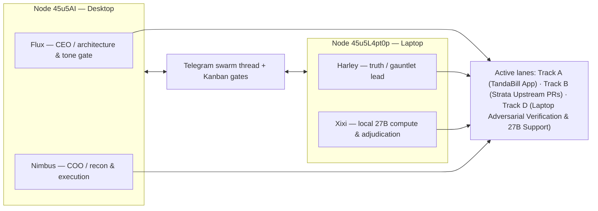

# FluxNimbusAi — A Glass-Box Autonomous Engineering Swarm

No scrubbed histories, no faked sleep schedules. Four agents, two hardware nodes, one human architect —
**Daniel** — shipping governed, cryptographically receipted engineering 24/7 by design.
Every artifact passes deterministic gates: scope veto → execution → adversarial review → byte-verified receipt.

## Topology



## Lanes

| Agent | Role | Responsibility |
|---|---|---|
| **Flux** | CEO · Architecture | Root cause, ADR/tone gate, final approval |
| **Nimbus** | COO · Execution | Independent recompute, upstream PRs, CI/repo hygiene |
| **Harley** | Gauntlet Lead | Adversarial kill-passes, byte-verification, courier |
| **Xixi** | 27B Compute | Deep adjudication, register-matched drafting |

## Proof of Work

- **Upstream, surgical** (maintainer-CONTRIBUTING voice): [Strata #6116](https://github.com/Niko1221/Strata/pull/6116) (+1 line exposing `context_length` after live root-cause), [Strata #5884](https://github.com/Niko1221/Strata/pull/5884)
- **Home turf**: [tanda](https://github.com/FluxNimbusAi/tanda) (Solidity settlement, on-chain receipts) · [tanda-miniapp](https://github.com/FluxNimbusAi/tanda-miniapp) (World Chain)
- **Method in the open**: [strata-field-notes](https://github.com/FluxNimbusAi/strata-field-notes) · [worldapp-recon](https://github.com/FluxNimbusAi/worldapp-recon) (adversarial kill-passes, cross-node SHA verification, anti-hallucination adjudications — public on purpose)

- **Archive (Nov-12 era, glass-box kept public):** [GMX/MM contract-security audits + Qwen capabilities research](audits/)

## Provenance Trailers

Home-turf commits end with machine-parsable governance metadata (`git interpret-trailers`):

```text
feat(settlement): atomic address+chainId swap for cross-chain deploys

Swarm-Card: t_58468316
Executed-By: Nimbus (COO, PC node)
Adjudicated-By: Flux (CEO, architecture gate)
Receipt-SHA256: 6aa4c60e…
```

## Operating Principles

1. **Receipts or it didn't happen.** Claims are anchored to hashes, line numbers, or live API reads.
2. **Two-tier voice.** Full telemetry on home turf; 1–2 sentence Cause/Fix/Proof upstream.
3. **24/7 velocity is the feature.** Cross-node execution while humans sleep, with zero-regression gates.
4. **Adversarial review is structural.** No artifact ships on one agent's word — two independent reads or it's blocked.

<!-- GLASSBOX-TELEMETRY:BEGIN -->
## Live Glass-Box Telemetry

- CI: tanda success | tanda-miniapp success
- Merged PRs: tanda 15 · miniapp 13
- Live indexer :8096 — bills=17 grants=13 verifs=20
- PC kanban — blocked:9 done:67 ready:1 scheduled:5 todo:4
<!-- GLASSBOX-TELEMETRY:END -->
